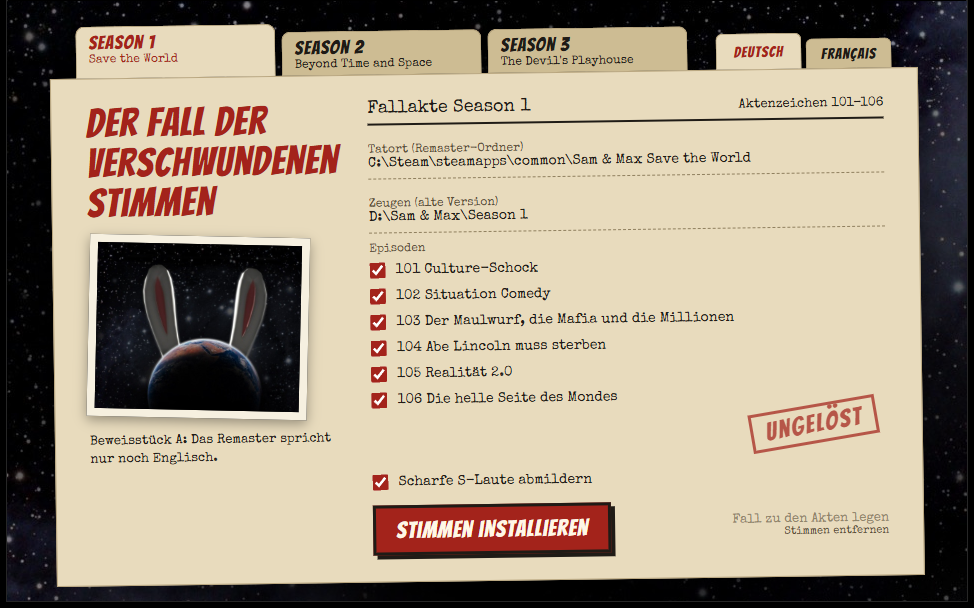

  

<h1 align="center">Dub Police</h1>

  Die alten Sam-&amp;-Max-Spiele konnten Deutsch. Die Remaster sprechen nur noch Englisch. Dub Police holt die Originalaufnahmen zurück: bei Season 1 direkt aus dem Remaster, bei Season 2 und 3 aus deiner alten Version. Echte Synchronsprecher, keine KI-Stimmen.

  

  <a href="README.md">English</a> · <b>Deutsch</b> · <a href="README.fr.md">Français</a>

Screenshot mit Beispielordnern

## Highlights

- **Die Originalstimmen** – die Aufnahmen von damals, keine neue Synchronisation und keine KI.
- **Alle drei Seasons** – Save the World, Beyond Time and Space und The Devil's Playhouse.
- **Szenen warten auf den Satz** – deutsche und französische Sätze sind oft länger als englische. Die Szenen machen ihnen Platz, damit niemand dazwischenredet. Stimmen werden nie beschleunigt.
- **Lippen und Timing ziehen mit** – auf Deutsch folgen die Münder den deutschen Worten. Auf Französisch werden die englischen Mundbewegungen auf die Länge des neuen Satzes gestreckt.
- **Abgeschnittene Sätze repariert** – in der Season 1 von 2007 hört etwa jede zehnte Aufnahme mitten im Wort auf. Dub Police nimmt eine vollständige Aufnahme desselben Satzes derselben Figur oder ergänzt das Ende aus der Stimme desselben Sprechers.
- **Sauberer Klang** – die alten Aufnahmen werden behutsam ins heutige Format gebracht. Bei Deutsch mildert ein Schalter scharfe S-Laute ab.
- **Dein Spiel bleibt unberührt** – Dub Police legt nur Dateien dazu. Ein Klick entfernt alles wieder.
- **Einfach** – deine Steam-Spiele werden von selbst gefunden. Season, Sprache und Episoden wählen, fertig.

## Was verfügbar ist

| Season | Deutsch | Französisch |
|---|---|---|
| **1** Save the World | ✓ 11.421 von 11.433 Zeilen | ✓ 11.420 von 11.433 Zeilen |
| **2** Beyond Time and Space | ✓ 11.457 von 11.477 Zeilen | ✓ 11.457 von 11.477 Zeilen |
| **3** The Devil's Playhouse | ✓ 10.204 von 10.217 Zeilen | – keine französische Fassung vorhanden |

Die wenigen übrigen Zeilen haben keine passende alte Aufnahme und bleiben englisch.

## Woher die alten Stimmen kommen

| Season | Welche alte Version du brauchst |
|---|---|
| **1** Save the World | **Nichts zusätzlich.** Das Remaster bringt die alten Episoden von 2007 für seinen Retro-Modus mit, in der Sprache, die in Steam eingestellt ist. Dub Police findet sie selbst. Eine CD oder installierte alte Version geht weiterhin. |
| **2** Beyond Time and Space | Deine alte Version: installierter Ordner oder Disc |
| **3** The Devil's Playhouse | Deine alte Version: installierter Ordner |

Für Season 2 und 3 bringen die Remaster die alten Episoden nur auf Englisch mit. Die deutschen und französischen Stimmen müssen dort aus deiner eigenen alten Version kommen.

## Schnellstart

**Du brauchst:** Windows und ein Remaster auf Steam. Für Season 2 und 3 außerdem **deine eigene alte Version** in der gewünschten Sprache. Sie ist nicht enthalten.

1. `DubPolice.zip` von der [Release-Seite](https://github.com/MrLuigi938/DubPolice/releases/latest) laden, in einen beliebigen Ordner entpacken und das Spiel schließen.
2. `DubPolice.exe` in diesem Ordner starten. Oben links die Season wählen, oben rechts die Sprache.
3. **Zeugen** prüfen, also deine alte Version. Bei Season 1 ist das Feld meist schon gefüllt: Steam installiert die alten Episoden für den Retro-Modus mit dem Remaster, in der Sprache, die in Steam für das Spiel eingestellt ist. Sonst den installierten Ordner auswählen, bei Season 2 auch die Disc.
4. Episoden wählen und **Stimmen installieren** klicken. Eine ganze Season dauert etwa 12 bis 23 Minuten und belegt 620 bis 810 MB.
5. Im Spiel dieselbe Sprache einstellen. Fertig.

Das Fenster gibt es auf Deutsch und Französisch, passend zu den beiden Sprachen, die es zurückbringt.

## Dokumentation

| | |
|---|---|
| [Benutzung](docs/de/usage.md) | Welche alte Version du brauchst, Sprache wechseln, wieder entfernen, bekannte Grenzen, Hilfe bei Problemen |
| [Entwicklung](docs/de/development.md) | Aus dem Quellcode bauen, wie es funktioniert, Dateiformate |

## Gut zu wissen

Dub Police ist ein inoffizielles Fanprojekt und gehört nicht zu Skunkape Games, Telltale Games oder Steve Purcell. Es enthält keine Spieldaten. Du brauchst legale Kopien des Remasters und der alten Version.

## Danke

Teile des Formatwissens stammen aus den Open-Source-[TTG Tools](https://github.com/HeitorSpectre/TTG-Tools). Dub Police nutzt [Speex](https://speex.org), [LAME](https://lame.sourceforge.io) über [lameenc](https://github.com/chrisstaite/lameenc), [NumPy](https://numpy.org), [7-Zip](https://www.7-zip.org) und [pywebview](https://pywebview.flowrl.com), dazu die Schriften Bangers und Special Elite. Die Lizenzen liegen in [licenses/](licenses).

## Lizenz

Copyright © 2026 Luis Blum

Dub Police ist freie Software unter der [GNU General Public License v3.0](LICENSE). Du darfst es nutzen, ändern und weitergeben, auch kommerziell, solange geänderte Versionen unter derselben Lizenz und mit Quellcode veröffentlicht werden.

Die Lizenz gilt für den eigenen Code von Dub Police. Sie gilt nicht für die Spiele, ihre Aufnahmen, Namen und Figuren, auch nicht für das Sam-&-Max-Artwork im Hintergrundbild des Fensters. Fremde Bestandteile behalten ihre eigenen Lizenzen, siehe [licenses/](licenses).

Dub Police ist mit Hilfe von KI entstanden ([Claude](https://claude.ai) von Anthropic).
