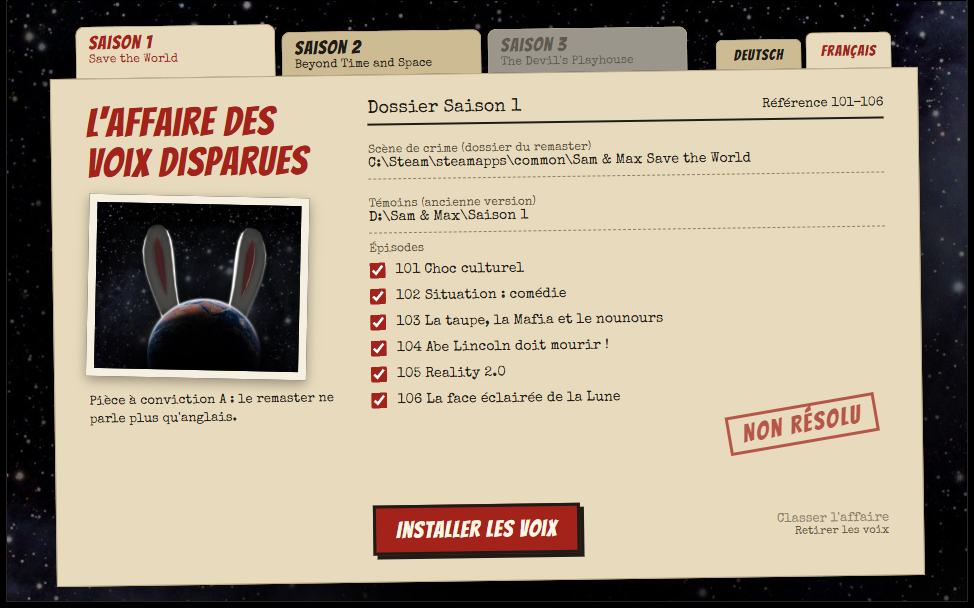

  

<h1 align="center">Dub Police</h1>

  Les anciens jeux Sam &amp; Max parlaient français et allemand. Les remasters ne parlent plus qu'anglais. Dub Police récupère les enregistrements d'origine dans votre ancienne version et les ramène. De vrais comédiens de doublage, aucune voix d'IA.

  

  <a href="README.md">English</a> · <a href="README.de.md">Deutsch</a> · <b>Français</b>

Capture d'écran avec des dossiers d'exemple

## Points forts

- **Les voix d'origine** – les enregistrements de l'époque, ni nouveau doublage ni IA.
- **Les trois saisons** – Save the World, Beyond Time and Space et The Devil's Playhouse (cette dernière uniquement en allemand).
- **Les scènes attendent la fin de la phrase** – les phrases françaises et allemandes sont souvent plus longues que les anglaises. Les scènes leur laissent la place, pour que personne ne coupe la parole. Les voix ne sont jamais accélérées.
- **Lèvres et rythme suivent** – les mouvements de la bouche sont étirés à la longueur de la nouvelle phrase.
- **Un son propre** – les anciens enregistrements sont soigneusement convertis au format actuel.
- **Votre jeu reste intact** – Dub Police ne fait qu'ajouter des fichiers. Un clic retire tout.
- **Simple** – vos jeux Steam sont trouvés automatiquement. Choisissez la saison, la langue et les épisodes, c'est tout.

## Ce qui est disponible

| Saison | Français | Allemand |
|---|---|---|
| **1** Save the World | ✓ 11 392 répliques sur 11 432 | ✓ 11 392 répliques sur 11 432 |
| **2** Beyond Time and Space | ✓ 11 446 répliques sur 11 477 | ✓ 11 445 répliques sur 11 477 |
| **3** The Devil's Playhouse | – pas de version française | ✓ 10 159 répliques sur 10 172 |

Les rares répliques restantes n'ont pas d'enregistrement ancien correspondant et restent en anglais.

## Démarrage rapide

**Il vous faut :** Windows, un remaster sur Steam et **votre propre copie de l'ancien jeu** dans la langue souhaitée. Elle n'est pas fournie.

1. Téléchargez `DubPolice.exe` depuis la [page des versions](https://github.com/MrLuigi938/DubPolice/releases/latest) et fermez le jeu.
2. Lancez-le. Choisissez la saison en haut à gauche et la langue en haut à droite (**Français**).
3. Cliquez sur **Témoins** et sélectionnez votre ancienne version : le dossier installé ou, pour la saison 2, aussi le disque.
4. Choisissez les épisodes et cliquez sur **Installer les voix**. Une saison complète prend environ 12 à 23 minutes et occupe 620 à 810 Mo.
5. Réglez le jeu sur la même langue. Terminé.

## Documentation

| | |
|---|---|
| [Utilisation](docs/fr/usage.md) | Quelle ancienne version il vous faut, changer de langue, tout retirer, limites connues, dépannage |
| [Développement](docs/fr/development.md) | Compiler depuis les sources, fonctionnement, formats de fichiers |

## Bon à savoir

Dub Police est un projet de fan non officiel, sans lien avec Skunkape Games, Telltale Games ou Steve Purcell. Il ne contient aucune donnée de jeu. Il vous faut des copies légales du remaster et de l'ancienne version.

## Remerciements

Une partie des connaissances sur les formats vient des [TTG Tools](https://github.com/HeitorSpectre/TTG-Tools), un projet open source. Dub Police utilise [Speex](https://speex.org), [LAME](https://lame.sourceforge.io) via [lameenc](https://github.com/chrisstaite/lameenc), [NumPy](https://numpy.org), [7-Zip](https://www.7-zip.org) et [pywebview](https://pywebview.flowrl.com), ainsi que les polices Bangers et Special Elite. Leurs licences se trouvent dans [licenses/](licenses).

## Licence

Copyright © 2026 Luis Blum. Aucune licence open source n'a encore été choisie.

Dub Police a été créé avec l'aide de l'IA ([Claude](https://claude.ai) d'Anthropic).
