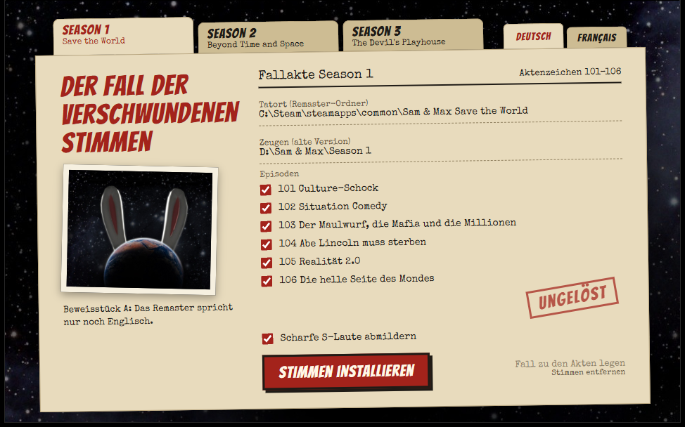

  

<h1 align="center">Dub Police</h1>

  The old Sam &amp; Max games had German and French voices. The remasters only speak English. Dub Police takes the original recordings from your own old copy and brings them back. Real voice actors, no AI voices.

  

  <b>English</b> · <a href="README.de.md">Deutsch</a> · <a href="README.fr.md">Français</a>

Screenshot with example folders

## Highlights

- **The original voices** – the recordings from back then, not a new dub and not AI.
- **All three seasons** – Save the World, Beyond Time and Space and The Devil's Playhouse.
- **Scenes wait for the sentence** – German and French lines are often longer than English ones. Scenes make room for them, so nobody talks over anyone. Voices are never sped up.
- **Lips and timing come along** – mouth movements are stretched to the length of the new line.
- **Clean sound** – the old recordings are carefully brought up to today's format. For German, a switch softens sharp S sounds.
- **Your game stays untouched** – Dub Police only adds files. One click removes everything.
- **Simple** – it finds your Steam games by itself. Pick season, language and episodes, then start.

## What is available

| Season | German | French |
|---|---|---|
| **1** Save the World | ✓ 11,422 of 11,433 lines | ✓ 11,420 of 11,433 lines |
| **2** Beyond Time and Space | ✓ 11,457 of 11,477 lines | ✓ 11,457 of 11,477 lines |
| **3** The Devil's Playhouse | ✓ 10,204 of 10,217 lines | – no French version exists |

The few remaining lines have no matching old recording and stay in English.

## Quick start

**You need:** Windows, a remaster on Steam and **your own copy of the old game** in the language you want. It is not included.

1. Download `DubPolice.zip` from the [releases page](https://github.com/MrLuigi938/DubPolice/releases/latest), unpack it to a folder of your choice and close the game.
2. Start `DubPolice.exe` in that folder. Choose the season at the top left and the language at the top right.
3. Click **Zeugen / Témoins** and select your old version: the installed folder, or for Season 2 also the disc.
4. Choose your episodes and click **Stimmen installieren / Installer les voix**. A full season takes about 12 to 23 minutes and 620 to 810 MB.
5. Set the game to the same language. Done.

The window itself is available in German and French, the two languages it brings back.

## Documentation

| | |
|---|---|
| [Usage](docs/usage.md) | Which old version you need, switching language, removing it again, known limits, troubleshooting |
| [Development](docs/development.md) | Building from source, how it works, file formats |

## Good to know

Dub Police is an unofficial fan project and not connected to Skunkape Games, Telltale Games or Steve Purcell. It contains no game data. You need legal copies of both the remaster and the old version.

## Thanks

Parts of the format knowledge come from the open-source [TTG Tools](https://github.com/HeitorSpectre/TTG-Tools). Dub Police uses [Speex](https://speex.org), [LAME](https://lame.sourceforge.io) through [lameenc](https://github.com/chrisstaite/lameenc), [NumPy](https://numpy.org), [7-Zip](https://www.7-zip.org) and [pywebview](https://pywebview.flowrl.com), plus the fonts Bangers and Special Elite. Their licenses are in [licenses/](licenses).

## License

Copyright © 2026 Luis Blum

Dub Police is free software under the [GNU General Public License v3.0](LICENSE). You may use, change and share it, also commercially, as long as changed versions are published under the same license with their source code.

The license covers Dub Police's own code. It does not cover the games, their recordings, names and characters, including the Sam & Max artwork in the window's background image. Third-party components keep their own licenses, listed in [licenses/](licenses).

Dub Police was built with the help of AI ([Claude](https://claude.ai) by Anthropic).
