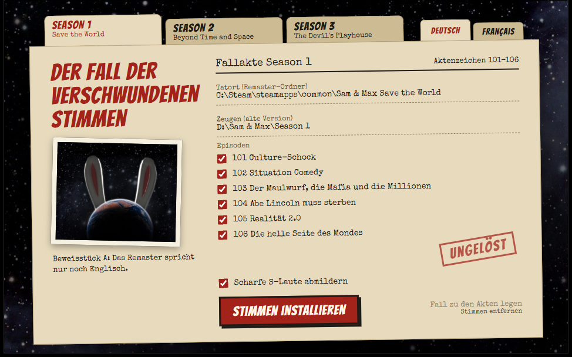

  

<h1 align="center">Dub Police</h1>

  The old Sam &amp; Max games had German and French voices. The remasters only speak English, and so do the original episodes in their retro mode. Dub Police takes the original recordings and brings them back: for Season 1 straight from the remaster, for Seasons 2 and 3 from your own old copy. Real voice actors, no AI voices.

  

  <b>English</b> · <a href="README.de.md">Deutsch</a> · <a href="README.fr.md">Français</a>

Screenshot with example folders

> **New in 2.0:** the retro mode speaks again too: Season 1 without choppy voices, Season 2 in German and French, Season 3 in German including its menus. For Season 3, the scene format of the 2010 engine was decoded. A badge on the main menu shows that Dub Police is active. All about it in the [release notes](docs/release-notes/2.0.0.md).

## Highlights

- **The original voices** – the recordings from back then, not a new dub and not AI.
- **All three seasons** – Save the World, Beyond Time and Space and The Devil's Playhouse.
- **The retro mode too** – the original episodes Steam installs with the remasters speak German or French in Season 2 and German in Season 3. One checkbox is enough.
- **Scenes wait for the sentence** – German and French lines are often longer than English ones. Scenes make room for them, so nobody talks over anyone. Voices are never sped up.
- **Lips and timing come along** – mouths follow the German or French words. Talking gadgets and characters with bone animations move in time with the new length.
- **Badge on the main menu** – a Dub Police sticker on the game's logo says "Deutsch aktiv – viel Spaß!" or "Français activé – bon jeu !", so you see at once that everything is ready.
- **Music with feeling** – when a cutscene waits for a longer line, the music fades out and back in. If you prefer, it simply keeps running.
- **Cut-off lines repaired** – in the 2007 Season 1 about one recording in ten stops in the middle of a word. Dub Police uses a complete take of the same line by the same actor, or completes the ending from the same actor's voice.
- **Clean sound** – the old recordings are carefully brought up to today's format. For German, a switch softens sharp S sounds.
- **Your game stays untouched** – Dub Police only adds files. One click removes everything.
- **Simple** – it finds your Steam games by itself. Pick season, language and episodes, then start.

## What is available

| Season | German | French |
|---|---|---|
| **1** Save the World | ✓ 11,421 of 11,433 lines | ✓ 11,420 of 11,433 lines |
| **2** Beyond Time and Space | ✓ 11,457 of 11,477 lines | ✓ 11,457 of 11,477 lines |
| **3** The Devil's Playhouse | ✓ 10,204 of 10,217 lines | – no French version exists |

The few remaining lines have no matching old recording and stay in English.

**Retro mode** (the original episodes inside the remaster):

| Season | German | French |
|---|---|---|
| **1** Save the World | ✓ repaired: no more choppy voices | ✓ repaired |
| **2** Beyond Time and Space | ✓ with adapted scenes | ✓ with adapted scenes |
| **3** The Devil's Playhouse | ✓ with adapted scenes | – no French version exists |

For Season 1, Steam already ships the original episodes in your language but plays them with the English timing. The checkbox **Retro-Version reparieren / Réparer la version rétro** switches to the matching scenes.

## Where the old voices come from

| Season | Old version you need |
|---|---|
| **1** Save the World | **Nothing extra.** The remaster brings the old 2007 episodes along for its retro mode, in the language Steam is set to. Dub Police finds them by itself. A disc or installed old version still works too. |
| **2** Beyond Time and Space | Your old version: installed folder or disc |
| **3** The Devil's Playhouse | Your old version: installed folder |

For Seasons 2 and 3, the remasters only ship the old episodes in English, so the German and French voices have to come from your own old copy.

## Quick start

**You need:** Windows and a remaster on Steam. For Seasons 2 and 3 also **your own copy of the old game** in the language you want. It is not included.

1. Download `DubPolice.zip` from the [releases page](https://github.com/MrLuigi938/DubPolice/releases/latest), unpack it to a folder of your choice and close the game.
2. Start `DubPolice.exe` in that folder. Choose the season at the top left and the language at the top right.
3. Check **Zeugen / Témoins**, your old version. For Season 1 it is usually filled in already: Steam installs the old episodes with the remaster for its retro mode, in the language set for the game in Steam. Otherwise select the installed folder, or for Season 2 also the disc.
4. Choose your episodes and click **Stimmen installieren / Installer les voix**. A full season takes about 12 to 23 minutes and 620 to 810 MB.
   For the Season 2 or 3 retro mode, also tick **Retro-Version auch vertonen / Doubler aussi la version rétro**.
5. Set the game to the same language. Done.

The window itself is available in German and French, the two languages it brings back.

## Documentation

| | |
|---|---|
| [Usage](docs/usage.md) | Which old version you need, switching language, removing it again, known limits, troubleshooting |
| [Development](docs/development.md) | Building from source, how it works, file formats |
| [Release notes 2.0](docs/release-notes/2.0.0.md) | What is new and how the Season 3 retro mode became possible |

## Good to know

Dub Police is an unofficial fan project and not connected to Skunkape Games, Telltale Games or Steve Purcell. It contains no game data. You need legal copies of both the remaster and the old version.

## Thanks

Parts of the format knowledge come from the open-source [TTG Tools](https://github.com/HeitorSpectre/TTG-Tools). The format description of [telltale-explorer](https://github.com/coccofresco/telltale-explorer) was the starting point for decoding the scenes of the Season 3 retro engine. Dub Police uses [Speex](https://speex.org), [LAME](https://lame.sourceforge.io) through [lameenc](https://github.com/chrisstaite/lameenc), [NumPy](https://numpy.org), [7-Zip](https://www.7-zip.org) and [pywebview](https://pywebview.flowrl.com), plus the fonts Bangers and Special Elite. Their licenses are in [licenses/](licenses).

## License

Copyright © 2026 Luis Blum

Dub Police is free software under the [GNU General Public License v3.0](LICENSE). You may use, change and share it, also commercially, as long as changed versions are published under the same license with their source code.

The license covers Dub Police's own code. It does not cover the games, their recordings, names and characters, including the Sam & Max artwork in the window's background image. Third-party components keep their own licenses, listed in [licenses/](licenses).

Dub Police was built with the help of AI ([Claude](https://claude.ai) by Anthropic).
